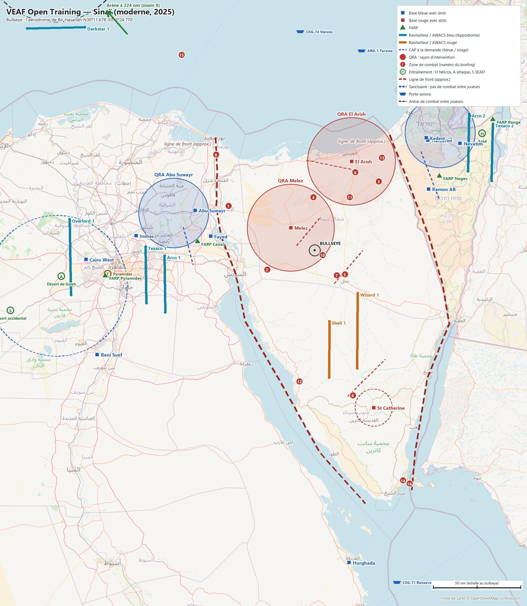
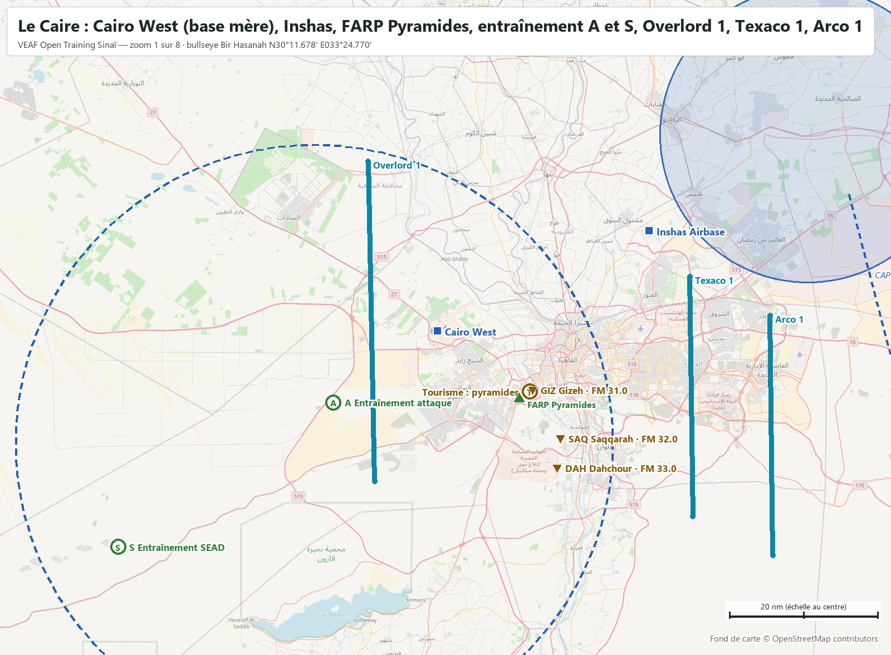
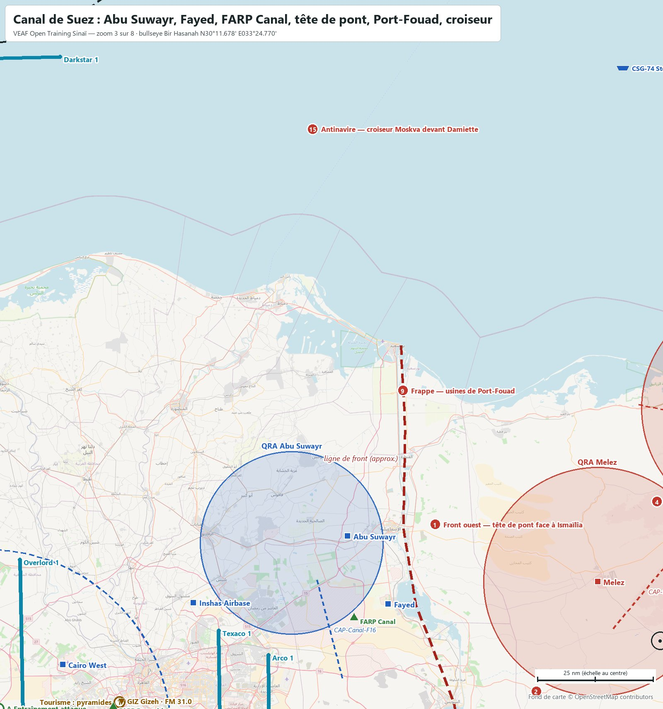
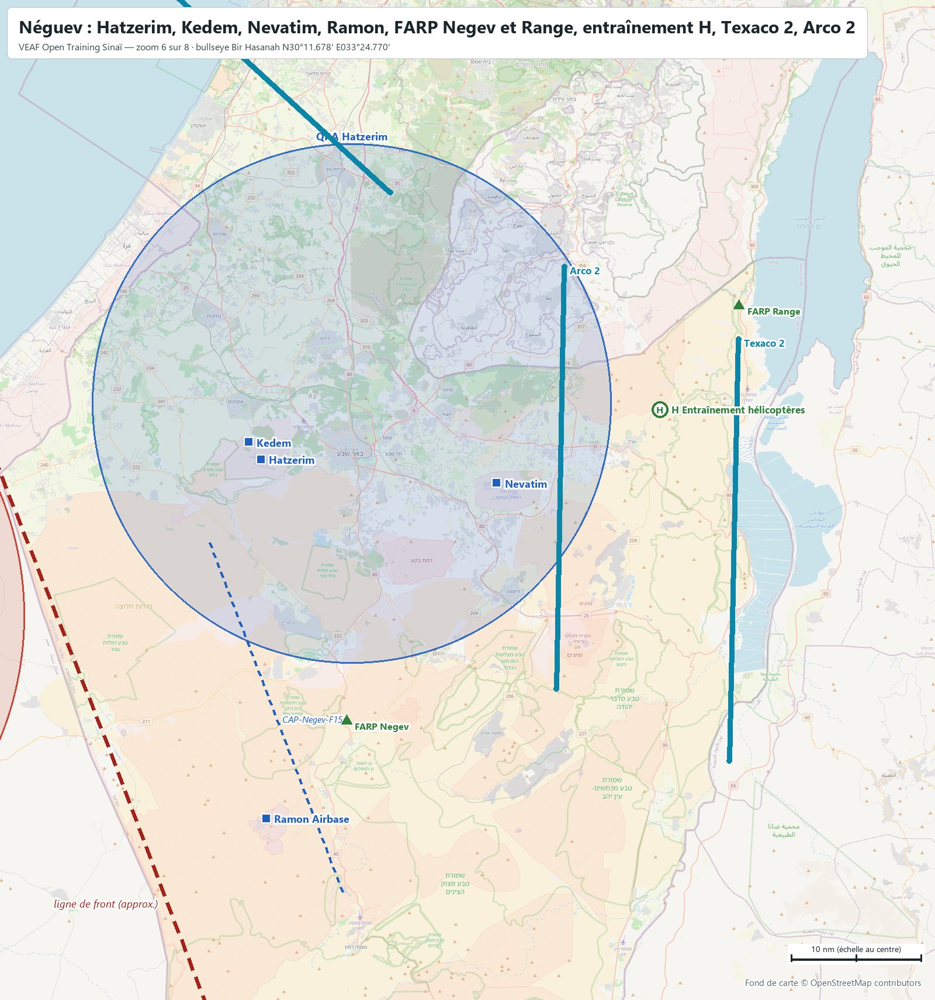
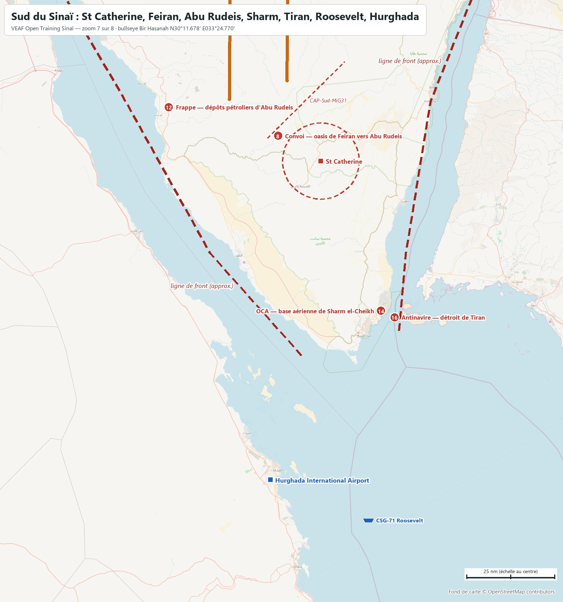
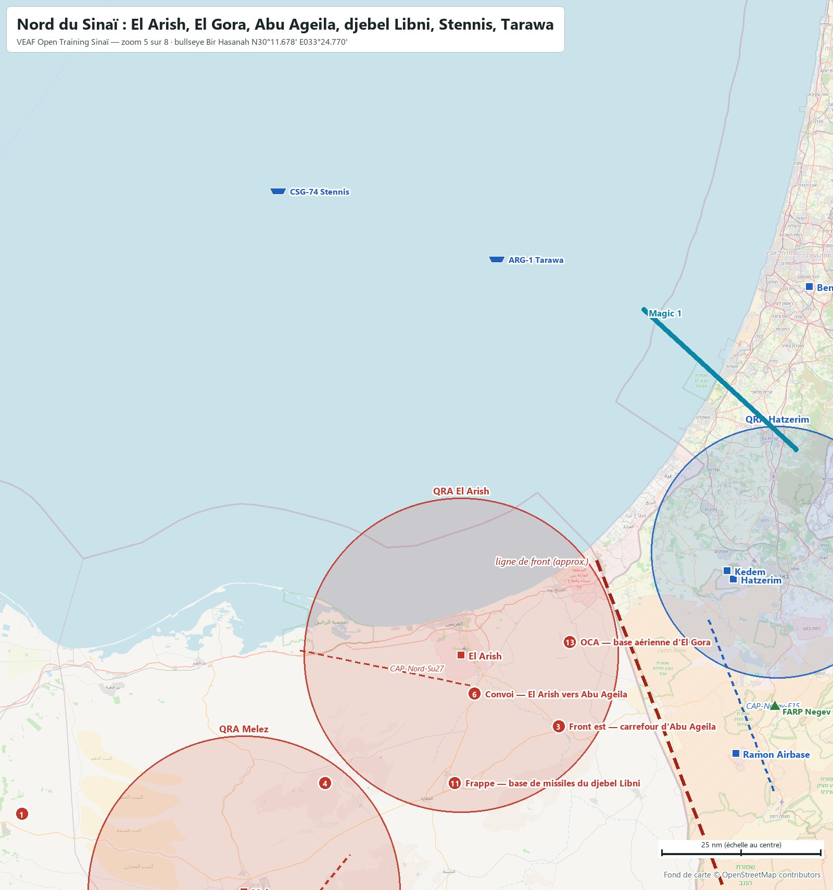
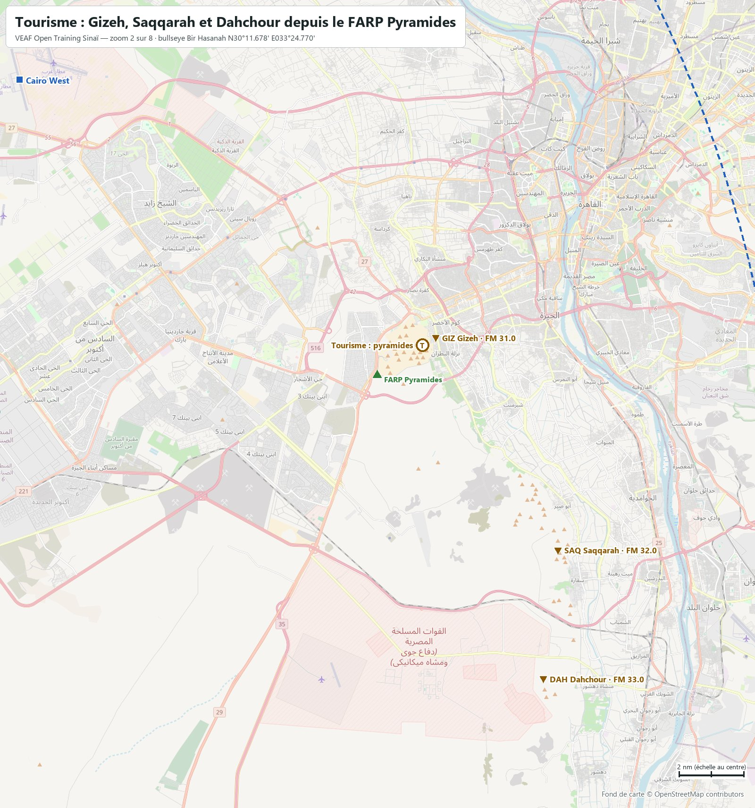
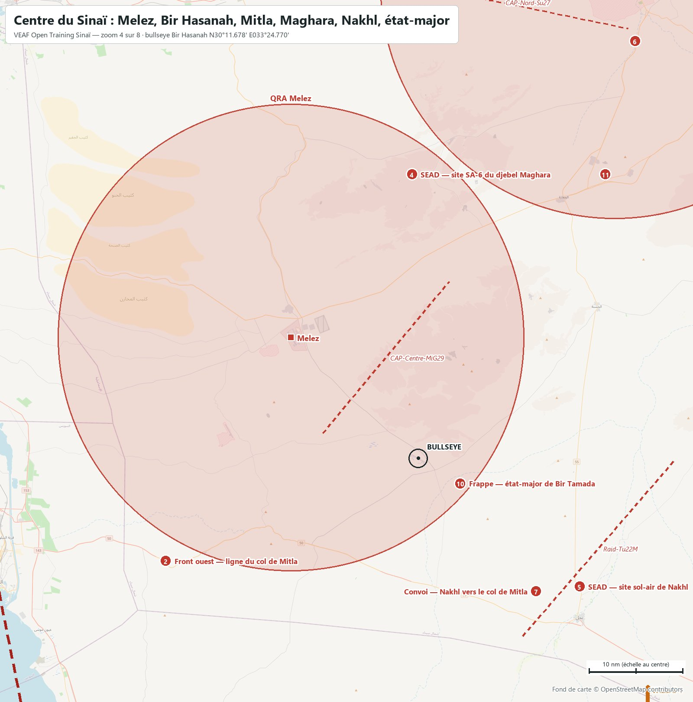
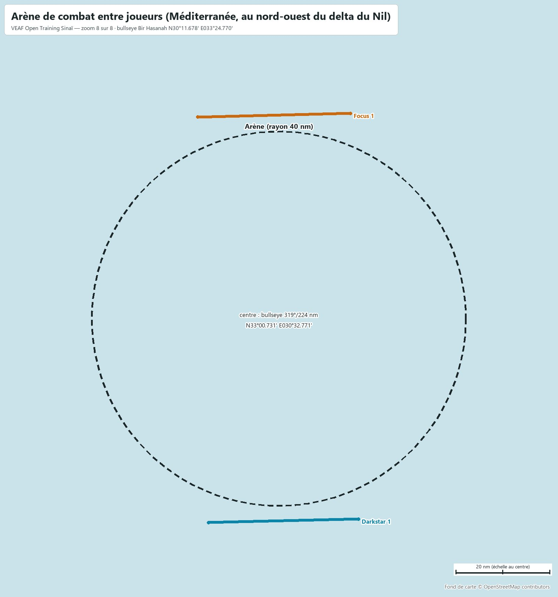

# VEAF Open Training — Sinaï (moderne, 2025)

Mission d'entraînement ouverte des serveurs VEAF, sur la carte **Sinai** de DCS, dans un scénario moderne. Ce document est le briefing complet : bases, soutien, zones, QRA, CAP, radio, météo. Les positions sont données en coordonnées (degrés, minutes décimales) et en relèvement/distance depuis le bullseye (relèvement vrai, nautiques).

| Mission | Date | Heure de base | Bullseye (bleu et rouge) | Météo | ATC |
|---|---|---|---|---|---|
| `VEAF_OpenTraining_Sinai_ICAO_HECA` | 15/10/2025 | 09:00 (heure de la carte, UTC+2) | aérodrome de Bir Hasanah · `N30°11.678' E033°24.770'` | celle du serveur VEAF | coupé sur tous les aérodromes |

**Sommaire** : [Situation](#situation) · [Carte](#carte) · [Bases](#bases) · [Ravitailleurs et AWACS](#ravitailleurs-et-awacs) · [Porte-avions](#porte-avions) · [Drones laser](#drones-laser) · [Entraînement](#entraînement) · [Tourisme aux pyramides](#tourisme-aux-pyramides) · [Zones de combat](#zones-de-combat) · [Missions scénarisées](#missions-scénarisées) · [QRA](#qra) · [CAP à la demande](#cap-à-la-demande) · [Combat entre joueurs](#combat-entre-joueurs) · [Défense aérienne](#défense-aérienne) · [Plan radio](#plan-radio) · [Météo et heures](#météo-et-heures) · [Commandes utiles](#commandes-utiles) · [Pour les créateurs de mission](#pour-les-créateurs-de-mission)

## Situation

Une force hostile a envahi la péninsule du Sinaï. L'Égypte et Israël, appuyés par les États-Unis et trois groupes aéronavals — le Stennis et le Tarawa en Méditerranée, le Roosevelt en mer Rouge —, la prennent en tenaille. Deux fronts : à l'ouest le canal de Suez, de Port-Saïd à Suez (78 nm), tenu par les bases égyptiennes du canal ; à l'est la frontière, de Rafah à Taba (113 nm), face aux bases israéliennes du Néguev. Le rouge tient tout le Sinaï, d'El Arish au nord à Sharm el-Cheikh au sud. Le bullseye commun est l'aérodrome de Bir Hasanah, au centre de la péninsule.

La version 5 opposait Israël (bleu) à l'Égypte (rouge) ; la v6 réunit les deux en bleu face à un Sinaï occupé, ce qui laisse au bleu l'arrière égyptien et ses pyramides, d'où la zone de tourisme.

Zones de combat, missions et soutien se pilotent par le menu radio F10 (*Zones de combat*, *Missions de combat*, *Assets*).

## Carte



Cartes zoomées, reprises dans les sections qu'elles illustrent : [Le Caire](docs/cartes/carte_01_lecaire.jpg) · [Tourisme](docs/cartes/carte_02_pyramides.jpg) · [Canal de Suez](docs/cartes/carte_03_canal.jpg) · [Centre du Sinaï](docs/cartes/carte_04_centre.jpg) · [Nord du Sinaï](docs/cartes/carte_05_nord.jpg) · [Néguev](docs/cartes/carte_06_negev.jpg) · [Sud du Sinaï](docs/cartes/carte_07_sud.jpg) · [Arène de combat entre joueurs (Méditerranée, au nord-ouest du delta du Nil)](docs/cartes/carte_08_arene.jpg).

Carrés : bases avec slots (bleu / rouge). Triangles : FARP. Traits pleins : hippodromes des ravitailleurs et AWACS. Pointillés : CAP à la demande. Cercles pleins : QRA. Pastilles vertes : entraînement (H hélicoptères, A attaque, S SEAD). Pastille marron T : tourisme aux pyramides. Pastilles rouges numérotées : zones de combat. Cercles en tirets : sanctuaires. Navires : porte-avions et LHA. L'arène est en Méditerranée, au nord-ouest du delta (zoom 8). Fond OpenStreetMap ; les lignes de front sont approximatives. Le briefing DCS montre cette carte puis les zooms (flèches sous l'image, molette pour grossir) ; la carte F10 porte les mêmes dessins : front, zones, QRA, sanctuaires et arène pour les deux camps, hippodromes de soutien pour leur camp seulement.

## Bases

| Base | Camp | Position | Bullseye | UHF | VHF | FM | Défense |
|---|---|---|---|---|---|---|---|
| **Abu Suwayr** | Bleu | `N30°34.523' E032°05.776'` | `289°/72 nm` | `251.1` | `118.85` | `39.5` | Hawk + Avenger |
| **Ben-Gurion** | Bleu | `N32°00.422' E034°53.586'` | `034°/133 nm` | `250.8` | `134.6` | `39.2` | Patriot + Avenger |
| **Beni Suef** | Bleu | `N29°11.874' E031°01.140'` | `245°/139 nm` | `251.3` | `127.1` | `39.7` | Hawk + Avenger |
| **Cairo West** (base mère) | Bleu | `N30°06.502' E030°53.739'` | `268°/131 nm` | `250.45` | `131.2` | `38.85` | Patriot + Hawk + Avenger |
| **Fayed** | Bleu | `N30°19.744' E032°16.049'` | `278°/60 nm` | `252.1` | `119.7` | `40.5` | Hawk + Avenger |
| **Hatzerim** | Bleu | `N31°14.316' E034°39.511'` | `045°/90 nm` | `252.15` | `119.75` | `40.55` | Hawk + NASAMS + Avenger |
| **Hurghada International Airport** | Bleu | `N27°10.588' E033°47.501'` | `173°/182 nm` | `251.55` | `119.6` | `39.95` | Hawk + Avenger |
| **Inshas Airbase** | Bleu | `N30°20.055' E031°26.795'` | `275°/102 nm` | `250.5` | `118.4` | `38.9` | Patriot + Avenger |
| **Kedem** | Bleu | `N31°15.637' E034°38.397'` | `044°/90 nm` | `250.15` | `118.15` | `38.55` | Hawk + NASAMS + Avenger |
| **Nevatim** | Bleu | `N31°12.500' E035°00.724'` | `053°/103 nm` | `252.2` | `132.4` | `40.6` | Patriot + Avenger |
| **Ramon Airbase** | Bleu | `N30°46.654' E034°39.969'` | `061°/74 nm` | `252.25` | `119.8` | `40.65` | Hawk + NASAMS |
| **El Arish** | Rouge | `N31°02.273' E033°49.146'` | `022°/55 nm` | `251.05` | `121.0` | `39.45` | SA-11 + SA-15 |
| **Melez** | Rouge | `N30°24.596' E033°08.985'` | `313°/19 nm` | `252.05` | `119.65` | `40.45` | SA-11 + SA-15 |
| **St Catherine** | Rouge | `N28°41.110' E034°03.758'` | `159°/97 nm` | `250.85` | `124.5` | `39.25` | SA-10 + SA-15 + Radar d'alerte 55G6 |
| **FARP Range** | Bleu | `N31°26.172' E035°22.524'` | `053°/126 nm` | — | — | `128.0` | dépôt de munitions (CTLD) |
| **FARP Negev** | Bleu | `N30°54.230' E034°47.218'` | `059°/83 nm` | — | — | `129.0` | dépôt de munitions (CTLD) |
| **FARP Pyramides** | Bleu | `N29°57.393' E031°06.547'` | `264°/121 nm` | — | — | `127.5` | dépôt de munitions (CTLD) |
| **FARP Canal** | Bleu | `N30°16.895' E032°07.458'` | `275°/67 nm` | — | — | `128.5` | dépôt de munitions (CTLD) |

Slots dynamiques, démarrage moteur chaud, carburant et munitions illimités. Les autres aérodromes de chaque camp lui appartiennent, sans slots : côté bleu les autres terrains d'Égypte (delta, canal, vallée du Nil) et d'Israël ; côté rouge les autres terrains du Sinaï (El Gora, Bir Hasanah, Baluza, Abu Rudeis, Sharm el-Cheikh, Taba). La Jordanie, l'Arabie saoudite, le Liban et la Syrie sont neutres. Fréquences : celles que DCS donne à chaque tour (ATC coupé).

<table><tr><td width="50%"><a href="docs/cartes/carte_01_lecaire.jpg"></a><br><sub>Le Caire : Cairo West (base mère), Inshas, FARP Pyramides, entraînement A et S, Overlord 1, Texaco 1, Arco 1</sub></td><td width="50%"><a href="docs/cartes/carte_03_canal.jpg"></a><br><sub>Canal de Suez : Abu Suwayr, Fayed, FARP Canal, tête de pont, Port-Fouad, croiseur</sub></td></tr><tr><td width="50%"><a href="docs/cartes/carte_06_negev.jpg"></a><br><sub>Néguev : Hatzerim, Kedem, Nevatim, Ramon, FARP Negev et Range, entraînement H, Texaco 2, Arco 2</sub></td><td width="50%"><a href="docs/cartes/carte_07_sud.jpg"></a><br><sub>Sud du Sinaï : St Catherine, Feiran, Abu Rudeis, Sharm, Tiran, Roosevelt, Hurghada</sub></td></tr></table>

## Ravitailleurs et AWACS

| Indicatif | Camp | Appareil | Rôle | UHF | TACAN | Niveau | Bullseye (milieu) | Hippodrome (extrémités) | Escorte |
|---|---|---|---|---|---|---|---|---|---|
| **Texaco 1** | Bleu | KC-135 | perche · canal | `290.0` | `50Y` | `FL220` | `262°/98 nm` | `N30°13.885' E031°33.193'`<br>`N29°41.406' E031°33.662'` | oui |
| **Arco 1** | Bleu | KC135MPRS | panier · canal | `291.0` | `51Y` | `FL180` | `258°/88 nm` | `N30°08.599' E031°45.728'`<br>`N29°36.117' E031°46.128'` | oui |
| **Texaco 2** | Bleu | KC-135 | perche · Néguev | `292.0` | `52Y` | `FL240` | `061°/115 nm` | `N31°23.539' E035°22.481'`<br>`N30°51.084' E035°21.675'` | oui |
| **Arco 2** | Bleu | KC135MPRS | panier · Néguev | `293.0` | `53Y` | `FL200` | `054°/107 nm` | `N31°29.113' E035°06.822'`<br>`N30°56.653' E035°06.101'` | oui |
| **Overlord 1** | Bleu | E-3A | AWACS · ouest | `282.0` | — | `FL300` | `269°/140 nm` | `N30°29.406' E030°42.961'`<br>`N29°46.123' E030°43.955'` | oui |
| **Magic 1** | Bleu | E-3A | AWACS · est | `283.0` | — | `FL300` | `033°/113 nm` | `N31°56.775' E034°23.021'`<br>`N31°34.768' E034°51.145'` | oui |
| **Darkstar 1** | Bleu | E-3A | AWACS · arène | `285.0` | — | `FL300` | `311°/193 nm` | `N32°17.815' E030°53.052'`<br>`N32°17.078' E030°14.852'` | non |
| **Shell 1** | Rouge | IL-78M | ravitailleur rouge | `294.0` | — | `FL200` | `171°/57 nm` | `N29°30.970' E033°34.533'`<br>`N28°58.480' E033°34.352'` | oui |
| **Wizard 1** | Rouge | A-50 | AWACS rouge | `284.0` | — | `FL300` | `152°/52 nm` | `N29°47.111' E033°53.247'`<br>`N29°03.795' E033°52.872'` | oui |
| **Focus 1** | Rouge | A-50 | AWACS rouge · arène | `286.0` | — | `FL300` | `326°/258 nm` | `N33°44.350' E030°50.967'`<br>`N33°43.572' E030°12.141'` | non |

Les ravitailleurs et AWACS du théâtre sont escortés (F-16C égyptiens à l'ouest, F-15C israéliens à l'est, Su-27 côté rouge). Marqueurs F10 : `-tanker <nom>` amène un ravitailleur au marqueur ; `-tankerlow` et `-tankerhigh` mettent le plus proche au FL120 ou au FL220.

## Porte-avions

| Navire | Position de départ | Bullseye | TACAN | ICLS | Link 4 | Tour | Slots sur le pont |
|---|---|---|---|---|---|---|---|
| **CSG-74 Stennis** (CSG-74 Stennis, 2 escorteurs) | `N32°15.427' E033°15.348'` | `356°/124 nm` | `74X STN` | `11` | `336.0` | `305.0` | 2 × F/A-18C, 2 × F/A-18C, 2 × F-14B |
| **CSG-71 Roosevelt** (CSG-71 Roosevelt, 2 escorteurs) | `N26°59.022' E034°19.072'` | `166°/198 nm` | `71X RSV` | `12` | `337.0` | `306.0` | 2 × F/A-18C, 2 × F-14B, 2 × F-14B |
| **ARG-1 Tarawa** (ARG-1 Tarawa, 1 escorteur) | `N32°04.712' E033°55.790'` | `013°/116 nm` | `73X TRW` | `13` | — | `307.0` | 2 × AV-8B, 2 × AV-8B |

<table><tr><td width="50%"><a href="docs/cartes/carte_05_nord.jpg"></a><br><sub>Nord du Sinaï : El Arish, El Gora, Abu Ageila, djebel Libni, Stennis, Tarawa</sub></td><td width="50%"><a href="docs/cartes/carte_07_sud.jpg"></a><br><sub>Sud du Sinaï : St Catherine, Feiran, Abu Rudeis, Sharm, Tiran, Roosevelt, Hurghada</sub></td></tr></table>

Le Stennis et le Tarawa en Méditerranée, au large d'El Arish et de Gaza ; le Roosevelt en mer Rouge, au sud de Ras Mohammed. Slots à froid et à chaud sur les ponts, plus les slots dynamiques. Le menu F10 *CARRIER OPS* met chaque porte-avions face au vent, avec son ravitailleur S-3B (Stennis 56Y U296.0, Roosevelt 57Y U297.0) et son hélicoptère de sauvetage.

## Drones laser

| Drone | Appareil | Au-dessus de | Code laser | Radio | Hauteur | Bullseye |
|---|---|---|---|---|---|---|
| **Reaper 1** | MQ-9 Reaper | champ de tir d'attaque | `1511` | `35.55 FM` | `3 000 m sol` | `265°/146 nm` |
| **Reaper 2** | MQ-9 Reaper | col de Mitla | `1512` | `35.6 FM` | `3 000 m sol` | `248°/29 nm` |

Reaper 1 tourne au-dessus du champ de tir d'attaque du désert de Gizeh, Reaper 2 au-dessus de la ligne du col de Mitla (Z02), et chacun désigne au laser ce qu'il voit. CTLD le maintient à 3 000 m sol : l'artillerie antiaérienne de la zone peut l'abattre, et le menu F10 *Assets* le remet en vol. Il ne désigne que des véhicules — ce que sont aussi les cibles des niveaux faciles — et ne marque qu'à 10 km. Pas de drone sur une zone dont les SAM portent plus loin que le laser.

## Entraînement

Loin du front, à quelques minutes d'une base. Trois niveaux par famille, chacun comprenant ceux d'en dessous. **Activez un seul niveau par famille à la fois.** Les cibles des niveaux faciles sont des véhicules immobiles, en tir interdit : chauds au pod, inertes.

<table><tr><td width="50%"><a href="docs/cartes/carte_01_lecaire.jpg"></a><br><sub>Le Caire : Cairo West (base mère), Inshas, FARP Pyramides, entraînement A et S, Overlord 1, Texaco 1, Arco 1</sub></td><td width="50%"><a href="docs/cartes/carte_06_negev.jpg"></a><br><sub>Néguev : Hatzerim, Kedem, Nevatim, Ramon, FARP Negev et Range, entraînement H, Texaco 2, Arco 2</sub></td></tr></table>

### Hélicoptères — Arad (désert de Judée, près du FARP Range)

`N31°18.143' E035°15.400'` · bullseye `054°/116 nm` · rayon 1.3 nm · menu F10 « Entraînement hélicoptères » · Arco 2 (panier, TACAN 53Y, 293.0) à 8 nm ; Texaco 2 (perche, TACAN 52Y, 292.0) à 6 nm

- **H1 Hélico Arad — facile** — Champ de tir hélicoptères d'Arad, sur le plateau au nord-est de la ville, à 10 nm du FARP Range : cibles inertes (chars, blindés et camions immobiles, tir interdit).
- **H2 Hélico Arad — moyen** — Champ de tir hélicoptères d'Arad : de l'artillerie antiaérienne légère (ZU-23, parfois un Shilka) en plus des cibles du niveau facile.
- **H3 Hélico Arad — difficile** — Champ de tir hélicoptères d'Arad, avec une défense courte portée réaliste : un SA-13 et une équipe de lance-missiles portatifs SA-18, à guidage infrarouge.

### Attaque — désert de Gizeh (au sud-ouest de Cairo West)

`N29°56.835' E030°37.497'` · bullseye `265°/146 nm` · rayon 1.3 nm · menu F10 « Entraînement attaque » · Arco 1 (panier, TACAN 51Y, 291.0) à 59 nm ; Texaco 1 (perche, TACAN 50Y, 290.0) à 49 nm

- **A1 Attaque désert de Gizeh — facile** — Champ de tir air-sol dans le désert au sud-ouest de Cairo West, à 17 nm de la base : blindés et camions immobiles en tir interdit, dépôt de carburant et poste de commandement. Le drone Reaper 1 tourne au-dessus.
- **A2 Attaque désert de Gizeh — moyen** — Champ de tir du désert de Gizeh : une compagnie blindée active et de l'artillerie antiaérienne légère en plus des cibles du niveau facile.
- **A3 Attaque désert de Gizeh — difficile** — Champ de tir du désert de Gizeh : un second groupe blindé et une défense courte portée à guidage infrarouge (SA-13 ou SA-9), avec un Shilka.

### SEAD — désert occidental (au nord-ouest du Fayoum)

`N29°37.218' E030°03.892'` · bullseye `259°/178 nm` · rayon 1.6 nm · menu F10 « Entraînement SEAD » · Arco 1 (panier, TACAN 51Y, 291.0) à 89 nm ; Texaco 1 (perche, TACAN 50Y, 290.0) à 78 nm

- **S1 SEAD désert occidental — facile** — Site SEAD dans le désert occidental, à 52 nm au sud-ouest de Cairo West : une batterie sol-air moyenne portée, SA-6 ou SA-11 tirée au sort.
- **S2 SEAD désert occidental — moyen** — Site SEAD du désert occidental : la batterie moyenne portée est protégée par une défense courte portée (SA-15, SA-8).
- **S3 SEAD désert occidental — difficile** — Site SEAD du désert occidental en réseau Skynet : un radar d'alerte avancée guide les batteries, qui restent éteintes jusqu'au dernier moment.

## Tourisme aux pyramides

`N29°58.296' E031°08.157'` · bullseye `264°/119 nm` · menu F10 « Tourisme »

Visite aérienne des pyramides, hors combat, au départ du FARP Pyramides (2 nm au sud-ouest du plateau). Circuit : Gizeh (Khéops, Khéphren, Mykérinos, le Sphinx), puis Saqqarah (pyramide à degrés de Djoser, 8 nm au sud-sud-est), puis Dahchour (pyramide rouge et pyramide rhomboïdale, 4 nm plus au sud). Une balise radio FM à chaque site (GIZ 31.0, SAQ 32.0, DAH 33.0) ; survolez un monument à moins de 1 500 ft sol et un guide vous le raconte. Excursion : la pyramide effondrée de Meïdoum, 25 nm au sud de Dahchour. Dans le sanctuaire bleu du Caire : un appareil rouge y est détruit.

| Balise | Site | FM | Position |
|---|---|---|---|
| **GIZ** | Gizeh | `31.0` | `N29°58.523' E031°08.629'` |
| **SAQ** | Saqqarah | `32.0` | `N29°51.947' E031°13.000'` |
| **DAH** | Dahchour | `33.0` | `N29°47.963' E031°12.471'` |

Chaque balise répète son indicatif en morse. Le guide parle à tout appareil d'un joueur qui passe sous 1 500 ft sol au-dessus d'un monument (Khéops, Khéphren, Mykérinos, le Sphinx, Djoser, la pyramide rouge, la rhomboïdale, Meïdoum) : un message par monument, renouvelé après 10 minutes. Le plateau est dans le sanctuaire bleu du Caire : un appareil rouge y est détruit, la visite est réservée aux bleus. La zone F10 *Tourisme* fait seulement apparaître des autocars au parking du plateau ; le circuit, les balises et le guide sont là en permanence. La présence des monuments dans le décor DCS est à confirmer en jeu.



## Zones de combat

Les numéros renvoient à la carte. Chaque zone s'active par le menu F10 *Zones de combat*, qui redonne son briefing et sa position. Une partie des sites change d'une activation à l'autre (batterie tirée au sort, groupes blindés tirés au sort).

<table><tr><td width="50%"><a href="docs/cartes/carte_03_canal.jpg"></a><br><sub>Canal de Suez : Abu Suwayr, Fayed, FARP Canal, tête de pont, Port-Fouad, croiseur</sub></td><td width="50%"><a href="docs/cartes/carte_04_centre.jpg"></a><br><sub>Centre du Sinaï : Melez, Bir Hasanah, Mitla, Maghara, Nakhl, état-major</sub></td></tr><tr><td width="50%"><a href="docs/cartes/carte_05_nord.jpg"></a><br><sub>Nord du Sinaï : El Arish, El Gora, Abu Ageila, djebel Libni, Stennis, Tarawa</sub></td><td width="50%"><a href="docs/cartes/carte_07_sud.jpg"></a><br><sub>Sud du Sinaï : St Catherine, Feiran, Abu Rudeis, Sharm, Tiran, Roosevelt, Hurghada</sub></td></tr></table>

### Front

**Z01 Front ouest — tête de pont face à Ismaïlia** — `N30°37.038' E032°27.935'` · bullseye `297°/55 nm`

La brigade blindée rouge qui tient la rive est du canal, face à Ismaïlia : chars, blindés et lance-roquettes en position. Détruire les blindés et l'artillerie ; défense SA-15 possible, SA-13 et artillerie antiaérienne. Les Hawk d'Abu Suwayr couvrent la rive ouest. Ravitailleurs : Arco 1 (panier, TACAN 51Y, 291.0) à 46 nm ; Texaco 1 (perche, TACAN 50Y, 290.0) à 53 nm.

**Z02 Front ouest — ligne du col de Mitla** — `N30°00.680' E032°53.471'` · bullseye `248°/29 nm`

La ligne de défense rouge du col de Mitla, la route de Suez vers Nakhl : chars enterrés, blindés et artillerie automotrice. Défense courte portée seulement (SA-13, Shilka) : le drone Reaper 2 la désigne au laser. Ravitailleurs : Arco 1 (panier, TACAN 51Y, 291.0) à 59 nm ; Texaco 1 (perche, TACAN 50Y, 290.0) à 70 nm.

**Z03 Front est — carrefour d'Abu Ageila** — `N30°51.000' E034°07.200'` · bullseye `043°/54 nm`

Le carrefour fortifié d'Abu Ageila, sur la route d'El Arish à Ismaïlia, face à la frontière israélienne : une brigade mécanisée et ses lance-roquettes. Détruire les blindés et les Grad ; défense SA-8 et artillerie antiaérienne, sous la QRA d'El Arish. Ravitailleurs : Arco 2 (panier, TACAN 53Y, 293.0) à 51 nm ; Texaco 2 (perche, TACAN 52Y, 292.0) à 64 nm.

### SEAD

**Z04 SEAD — site SA-6 du djebel Maghara** — `N30°42.000' E033°24.000'` · bullseye `359°/30 nm`

Le site SA-6 perché au djebel Maghara, au nord du Sinaï, relié à un radar d'alerte avancée en réseau Skynet. Détruire le radar de conduite de tir et les lanceurs ; un Shilka protège le site. Ravitailleurs : Arco 2 (panier, TACAN 53Y, 293.0) à 89 nm ; Texaco 1 (perche, TACAN 50Y, 290.0) à 100 nm.

**Z05 SEAD — site sol-air de Nakhl** — `N29°57.936' E033°44.784'` · bullseye `128°/22 nm`

Le site sol-air qui couvre le carrefour de Nakhl, au centre du Sinaï : une batterie SA-2 ou SA-3 tirée au sort, son radar d'alerte avancée et un Shilka. Sous la couverture lointaine du SA-10 du centre-sud. Ravitailleurs : Arco 2 (panier, TACAN 53Y, 293.0) à 91 nm ; Texaco 2 (perche, TACAN 52Y, 292.0) à 99 nm.

### Convois

**Z06 Convoi — El Arish vers Abu Ageila** — `N30°56.152' E033°51.671'` · bullseye `027°/50 nm`

Un convoi de renforts quitte El Arish par la route du sud-est vers le carrefour d'Abu Ageila. L'arrêter avant Abu Ageila ; il porte sa propre artillerie antiaérienne (ZU-23) et un SA-9. Ravitailleurs : Arco 2 (panier, TACAN 53Y, 293.0) à 64 nm ; Texaco 2 (perche, TACAN 52Y, 292.0) à 77 nm.

**Z07 Convoi — Nakhl vers le col de Mitla** — `N29°57.423' E033°39.395'` · bullseye `138°/19 nm`

Des renforts blindés roulent de Nakhl vers le col de Mitla, pour renforcer la ligne face à Suez. Les arrêter avant le col ; le convoi est escorté par un SA-13. Ravitailleurs : Arco 2 (panier, TACAN 53Y, 293.0) à 95 nm ; Texaco 2 (perche, TACAN 52Y, 292.0) à 103 nm.

**Z08 Convoi — oasis de Feiran vers Abu Rudeis** — `N28°48.247' E033°49.986'` · bullseye `165°/86 nm`

Un convoi de carburant descend l'oued Feiran vers les dépôts d'Abu Rudeis, sur le golfe de Suez. Le détruire avant la côte ; il porte sa propre artillerie antiaérienne. Sous la couverture du SA-10 de St Catherine. Ravitailleurs : Arco 1 (panier, TACAN 51Y, 291.0) à 118 nm ; Texaco 1 (perche, TACAN 50Y, 290.0) à 130 nm.

### Frappes en profondeur

**Z09 Frappe — usines de Port-Fouad** — `N31°06.118' E032°19.738'` · bullseye `314°/78 nm`

Les usines de la zone industrielle au sud de Port-Fouad, sur la rive est du canal, reconverties en ateliers d'armement : ateliers, hangars, réservoirs chimiques. Tout détruire ; défense SA-6, SA-9 et artillerie antiaérienne (reprise de la v5). Ravitailleurs : Arco 1 (panier, TACAN 51Y, 291.0) à 64 nm ; Texaco 1 (perche, TACAN 50Y, 290.0) à 66 nm.

**Z10 Frappe — état-major de Bir Tamada** — `N30°09.000' E033°30.000'` · bullseye `120°/5 nm`

Le poste de commandement de l'armée rouge du Sinaï, enterré à Bir Tamada : bunkers, centre de transmissions, véhicules de commandement. Tout détruire ; défense SA-15 et Shilka, sous la QRA de Melez. Ravitailleurs : Arco 1 (panier, TACAN 51Y, 291.0) à 90 nm ; Texaco 1 (perche, TACAN 50Y, 290.0) à 101 nm.

**Z11 Frappe — base de missiles du djebel Libni** — `N30°42.000' E033°48.000'` · bullseye `033°/36 nm`

Une base de missiles sol-sol au pied du djebel Libni, d'où les Scud menacent Le Caire et Beer-Sheva : lanceurs et camions de ravitaillement. Détruire les lanceurs ; défense SA-15 et Shilka. Ravitailleurs : Arco 2 (panier, TACAN 53Y, 293.0) à 69 nm ; Texaco 2 (perche, TACAN 52Y, 292.0) à 81 nm.

**Z12 Frappe — dépôts pétroliers d'Abu Rudeis** — `N28°56.323' E033°14.804'` · bullseye `186°/76 nm`

Les dépôts pétroliers d'Abu Rudeis, sur la côte du golfe de Suez : ils ravitaillent toute l'armée rouge du sud. Détruire réservoirs et pompes ; ZU-23 sur place, et le SA-10 de St Catherine à moins de 40 nm. Ravitailleurs : Arco 1 (panier, TACAN 51Y, 291.0) à 87 nm ; Texaco 1 (perche, TACAN 50Y, 290.0) à 99 nm.

### Bases aériennes

**Z13 OCA — base aérienne d'El Gora** — `N31°04.377' E034°09.279'` · bullseye `036°/65 nm`

La base aérienne d'El Gora, à 30 km de la frontière israélienne : chasseurs-bombardiers au parking, hangars et carburant. Tout détruire au sol ; défense SA-15 et Shilka. Ravitailleurs : Arco 2 (panier, TACAN 53Y, 293.0) à 49 nm ; Texaco 2 (perche, TACAN 52Y, 292.0) à 62 nm.

**Z14 OCA — base aérienne de Sharm el-Cheikh** — `N27°58.729' E034°23.109'` · bullseye `158°/142 nm`

L'aéroport de Sharm el-Cheikh, devenu base aérienne rouge à la pointe sud du Sinaï : avions de transport et hélicoptères d'attaque au sol, hangars. Tout détruire au sol ; défense SA-6 et ZU-23, plus le SA-15 permanent de la base. Ravitailleurs : Arco 1 (panier, TACAN 51Y, 291.0) à 169 nm ; Texaco 2 (perche, TACAN 52Y, 292.0) à 179 nm.

### Antinavire

**Z15 Antinavire — croiseur Moskva devant Damiette** — `N32°02.379' E031°56.947'` · bullseye `326°/134 nm`

Le croiseur lance-missiles rouge Moskva et deux frégates croisent en Méditerranée, à 38 nm au nord de Damiette, pour couper la route des porte-avions. Les couler : le Moskva porte des missiles sol-air à 40 nm, les frégates à courte portée (reprise de la v5, dont le croiseur était le Piotr Velikiy). Ravitailleurs : Arco 1 (panier, TACAN 51Y, 291.0) à 114 nm ; Texaco 1 (perche, TACAN 50Y, 290.0) à 110 nm.

**Z16 Antinavire — détroit de Tiran** — `N27°56.894' E034°27.427'` · bullseye `157°/145 nm`

Le rouge ferme le détroit de Tiran, la sortie du golfe d'Aqaba : une batterie de missiles antinavires (HY-2 Silkworm, portée 54 nm) à Ras Nasrani et un essaim de vedettes rapides dans le détroit. Détruire lanceurs et radar, couler les vedettes ; SA-15 permanent à Sharm el-Cheikh. Ravitailleurs : Arco 1 (panier, TACAN 51Y, 291.0) à 173 nm ; Texaco 2 (perche, TACAN 52Y, 292.0) à 180 nm.

## Missions scénarisées

- **Défense — raid rouge sur Abu Suwayr** — Deux Su-24M armés de missiles antiradar ouvrent la route à quatre Su-34 chargés de bombes, escortés de deux Su-30, partis du centre du Sinaï vers la base d'Abu Suwayr, sur le canal. Abattez les bombardiers avant le largage. Échec si la base est bombardée (constaté par vous : la mission ne le vérifie pas).
- **Interception — transport VIP de St Catherine à El Arish** — Un IL-76 emmène l'état-major rouge de St Catherine vers El Arish, escorté par deux MiG-29S. Interceptez-le avant El Arish : la fin de la route est sous la QRA et les défenses d'El Arish.

À lancer par le menu F10 *Missions de combat*. Elles n'ont pas de condition de réussite automatique : ce sont les pilotes qui jugent.

## QRA

| QRA | Défend | Centre | Bullseye | Rayon | Base | Réponse |
|---|---|---|---|---|---|---|
| **QRA Melez** | Rouge | `N30°24.596' E033°08.985'` | `313°/19 nm` | `25 nm` | Melez | dès 1 intrus : 1 vol parmi 2 × MiG-29S, 2 × Su-27<br>dès 3 intrus : 1 vol parmi 2 × Su-30, 4 × MiG-29S |
| **QRA El Arish** | Rouge | `N31°02.273' E033°49.146'` | `022°/55 nm` | `25 nm` | El Arish | dès 1 intrus : 1 vol parmi 2 × Su-27, 2 × MiG-29S<br>dès 3 intrus : 1 vol parmi 2 × Su-30, 4 × Su-27 |
| **QRA Abu Suwayr** | Bleu | `N30°33.016' E031°51.675'` | `285°/83 nm` | `20 nm` | Abu Suwayr | dès 1 intrus : 1 vol parmi 2 × F-16C bl.52d, 2 × Mirage 2000-5<br>dès 3 intrus : 1 vol parmi 4 × F-16C bl.52d, 4 × Mirage 2000-5 |
| **QRA Hatzerim** | Bleu | `N31°18.581' E034°47.675'` | `046°/98 nm` | `20 nm` | Hatzerim | dès 1 intrus : 1 vol parmi 2 × F-15C, 2 × F-16C bl.50<br>dès 3 intrus : 1 vol parmi 4 × F-15C, 4 × F-16C bl.50 |

Les chasseurs décollent 90 s après l'entrée du premier intrus dans le cercle ; les hélicoptères ne les déclenchent pas.

Couloirs sans QRA rouge : tout le sud du Sinaï (golfe de Suez, St Catherine, Sharm el-Cheikh, détroit de Tiran), le col de Mitla et Nakhl. Les bases bleues les plus proches (Fayed, Abu Suwayr, Hatzerim, Ramon) sont hors des cercles rouges.

## CAP à la demande

| Mission | Camp | Appareils | Niveau | Bullseye (milieu) | Description |
|---|---|---|---|---|---|
| **CAP bleue F-15C (Fox 3) — Néguev — FL250** | Bleu | 2 × F-15C | `FL250` | `057°/78 nm` | Deux F-15C israéliens couvrent le Néguev, de Hatzerim à Ramon, au FL250. Emport : AIM-9*4,AIM-120*4,Fuel. |
| **CAP bleue F-16C (Fox 3) — rive ouest du canal — FL220** | Bleu | 2 × F-16C bl.52d | `FL220` | `272°/72 nm` | Deux F-16C égyptiens patrouillent sur la rive ouest du canal, d'Ismaïlia à Suez, au FL220. Emport : AIM-120C*4,AIM-9M*2,ECM,Fuel*2. |
| **CAP rouge MiG-29S (Fox 1) — centre du Sinaï — FL220** | Rouge | 2 × MiG-29S | `FL220` | `342°/11 nm` | Deux MiG-29S armés de R-27R, R-73 et R-60 patrouillent entre Bir Hasanah et Bir Gifgafa, au FL220. Emport : R-73*2,R-60M*2,R-27R*2,Fuel-1500. |
| **CAP rouge Su-27 (Fox 1, longue portée) — nord du Sinaï — FL260** | Rouge | 2 × Su-27 | `FL260` | `010°/49 nm` | Deux Su-27 armés de R-27ER et R-73 patrouillent le long de la côte nord, de Bir al-Abd à El Arish, au FL260. Emport : R-73*4,R-27ER*6. |
| **CAP rouge MiG-31 (intercepteur haut et rapide, R-33) — sud du Sinaï — FL380** | Rouge | 2 × MiG-31 | `FL380` | `157°/79 nm` | Deux MiG-31 armés de R-33 patrouillent haut et vite au-dessus de St Catherine, au FL380. Emport : R-40R*2,R-33*4. |
| **Raid rouge Tu-22M3 à intercepter — Nakhl — FL300** | Rouge | 2 × Tu-22M3 | `FL300` | `116°/22 nm` | Deux bombardiers Tu-22M3 chargés de bombes tournent au-dessus de Nakhl, au FL300, prêts à frapper le canal : les intercepter. Emport : FAB-500*33. |

À lancer par le menu F10 *Missions de combat*.

## Combat entre joueurs

Des joueurs volent des deux côtés. Le combat entre joueurs est **permis sur le théâtre et dans l'arène, interdit dans les sanctuaires** : Le Caire, avec Cairo West, les pyramides et les champs de tir de l'ouest, côté bleu ; St Catherine côté rouge. El Arish et Melez n'en ont pas : leurs abords sont les plus disputés. Un pilote du camp adverse y est prévenu dès l'entrée, puis détruit au bout de 60 s, et les missiles tirés sur un appareil qui s'y trouve sont détruits. Les limites sont tracées sur la carte F10.

| Sanctuaire | Protège | Centre (bullseye) | Rayon |
|---|---|---|---|
| Le Caire | Bleu | `263°/149 nm` | `75.0 km` |
| St Catherine | Rouge | `159°/97 nm` | `20.0 km` |

### Arène

En Méditerranée, au nord-ouest du delta du Nil : `N33°00.731' E030°32.771'` · bullseye `319°/224 nm` · rayon 40 nm. Slots en départ en vol, bleus au sud, rouges au nord, face à face : l'arène AirQuake des Open Training VEAF, mêmes appareils et mêmes emports des deux côtés.



| Camp | Missiles | Slots | Départ |
|---|---|---|---|
| Bleu | Fox 3 | F-14B ×2, F/A-18C ×2 | `FL250` |
| Bleu | Fox 1 | F-14B ×2, F/A-18C ×2, Mirage 2000C ×2 | `FL250` |
| Rouge | Fox 3 | F/A-18C ×2, F-14B ×2 | `FL250` |
| Rouge | Fox 1 | F/A-18C ×2, Mirage 2000C ×2, F-14B ×2 | `FL250` |

AWACS de l'arène : Darkstar 1 (E-3A, bleu) U285.0, FL300 ; Focus 1 (A-50, rouge) U286.0, FL300.

## Défense aérienne

Défense permanente des deux camps : courte et moyenne portée sur chaque base avec slots, quelques batteries longue portée, des radars d'alerte avancée. Aucune ne couvre une base adverse avec slots (portées DCS). Chaque zone de combat a en plus sa propre défense, décrite dans sa fiche.

**Bleu** :

| Site | Système | Position | Bullseye |
|---|---|---|---|
| Hatzerim Hawk | Hawk | `N31°15.501' E034°41.987'` | `046°/92 nm` |
| Hatzerim NASAMS | NASAMS | `N31°13.052' E034°38.950'` | `046°/89 nm` |
| Kedem Avenger | Avenger | `N31°16.204' E034°38.029'` | `044°/90 nm` |
| Ramon Hawk | Hawk | `N30°47.708' E034°42.159'` | `061°/76 nm` |
| Ramon NASAMS | NASAMS | `N30°46.127' E034°38.874'` | `061°/73 nm` |
| Nevatim Patriot | Patriot | `N31°14.587' E035°02.186'` | `053°/105 nm` |
| Nevatim Avenger | Avenger | `N31°11.666' E035°00.140'` | `053°/102 nm` |
| Ben Gurion Patriot | Patriot | `N31°59.307' E034°55.763'` | `035°/133 nm` |
| Ben Gurion Avenger | Avenger | `N32°00.923' E034°52.606'` | `034°/133 nm` |
| EWR Mitzpe Ramon | Radar d'alerte FPS-117 | `N30°37.828' E034°48.132'` | `070°/77 nm` |
| EWR Dimona | Radar d'alerte FPS-117 | `N31°04.211' E035°04.989'` | `058°/101 nm` |
| Cairo West Patriot | Patriot | `N30°08.550' E030°54.548'` | `269°/130 nm` |
| Cairo West Hawk | Hawk | `N30°04.198' E030°52.830'` | `267°/132 nm` |
| Cairo West Avenger | Avenger | `N30°06.063' E030°55.211'` | `268°/130 nm` |
| Inshas Patriot | Patriot | `N30°22.220' E031°26.761'` | `276°/103 nm` |
| Inshas Avenger | Avenger | `N30°18.972' E031°26.812'` | `274°/102 nm` |
| Beni Suef Hawk | Hawk | `N29°11.906' E031°03.299'` | `245°/137 nm` |
| Beni Suef Avenger | Avenger | `N29°11.858' E031°00.030'` | `245°/139 nm` |
| Abu Suwayr Hawk | Hawk | `N30°33.860' E032°03.725'` | `288°/73 nm` |
| Abu Suwayr Avenger | Avenger | `N30°35.017' E032°06.747'` | `289°/71 nm` |
| Fayed Hawk | Hawk | `N30°19.730' E032°13.553'` | `278°/62 nm` |
| Fayed Avenger | Avenger | `N30°18.770' E032°16.056'` | `277°/60 nm` |
| Hurghada Hawk | Hawk | `N27°10.601' E033°45.079'` | `174°/181 nm` |
| Hurghada Avenger | Avenger | `N27°11.563' E033°47.508'` | `173°/181 nm` |
| EWR Mokattam | Radar d'alerte FPS-117 | `N30°01.730' E031°19.155'` | `265°/109 nm` |
| EWR Ain Sokhna | Radar d'alerte FPS-117 | `N29°38.992' E032°11.291'` | `243°/72 nm` |

**Rouge** :

| Site | Système | Position | Bullseye |
|---|---|---|---|
| El Arish SA-11 | SA-11 | `N31°02.292' E033°46.002'` | `020°/54 nm` |
| El Arish SA-15 | SA-15 | `N31°01.724' E033°50.230'` | `023°/55 nm` |
| Melez SA-11 | SA-11 | `N30°24.592' E033°12.108'` | `319°/17 nm` |
| Melez SA-15 | SA-15 | `N30°25.138' E033°07.904'` | `312°/20 nm` |
| St Catherine SA-10 | SA-10 | `N28°43.938' E034°01.943'` | `159°/93 nm` |
| St Catherine SA-15 | SA-15 | `N28°40.167' E034°04.362'` | `159°/98 nm` |
| Sinai Centre SA-10 | SA-10 | `N29°36.410' E033°28.367'` | `175°/35 nm` |
| Sharm SA-15 | SA-15 | `N27°59.807' E034°23.611'` | `158°/141 nm` |
| EWR El Arish | Radar d'alerte 55G6 | `N30°56.184' E033°46.516'` | `023°/48 nm` |
| EWR Bir Hasanah | Radar d'alerte 55G6 | `N30°13.844' E033°24.779'` | `000°/2 nm` |
| EWR Ras Sudr | Radar d'alerte 55G6 | `N29°35.778' E032°53.051'` | `218°/45 nm` |
| EWR St Catherine | Radar d'alerte 55G6 | `N28°43.242' E034°08.035'` | `156°/96 nm` |

## Plan radio

### Bleu

| Radio | Canal | Nom | MHz |
|---|---|---|---|
| Radio 1 (UHF) | `1` | Guard | `243` |
| Radio 1 (UHF) | `2` | Overlord 1 AWACS ouest | `282.0` |
| Radio 1 (UHF) | `3` | Magic 1 AWACS est | `283.0` |
| Radio 1 (UHF) | `4` | Texaco 1/BS/50Y | `290.0` |
| Radio 1 (UHF) | `5` | Arco 1/BM/51Y | `291.0` |
| Radio 1 (UHF) | `6` | Texaco 2/BS/52Y | `292.0` |
| Radio 1 (UHF) | `7` | Arco 2/BM/53Y | `293.0` |
| Radio 1 (UHF) | `8` | Stennis/74X/ICLS11 | `305.0` |
| Radio 1 (UHF) | `9` | Roosevelt/71X/ICLS12 | `306.0` |
| Radio 1 (UHF) | `10` | Tarawa/73X/ICLS13 | `307.0` |
| Radio 1 (UHF) | `11` | S-3B Stennis/56Y | `296.0` |
| Radio 1 (UHF) | `12` | S-3B Roosevelt/57Y | `297.0` |
| Radio 1 (UHF) | `13` | Darkstar 1 Arène | `285.0` |
| Radio 1 (UHF) | `14` | Cairo West | `250.45` |
| Radio 1 (UHF) | `15` | Abu Suwayr | `251.1` |
| Radio 1 (UHF) | `16` | Fayed | `252.1` |
| Radio 1 (UHF) | `17` | Hurghada International Airport | `251.55` |
| Radio 1 (UHF) | `18` | Hatzerim / 96X | `252.15` |
| Radio 1 (UHF) | `19` | Ramon Airbase / 105X | `252.25` |
| Radio 1 (UHF) | `20` | Nevatim | `252.2` |
| Radio 2 (V/UHF) | `1` | Guard | `121.5` |
| Radio 2 (V/UHF) | `2` | FARP Pyramides | `127.5` |
| Radio 2 (V/UHF) | `3` | FARP Range | `128.0` |
| Radio 2 (V/UHF) | `4` | FARP Canal | `128.5` |
| Radio 2 (V/UHF) | `5` | FARP Negev | `129.0` |
| Radio 2 (V/UHF) | `6` | Archer | `130.0` |
| Radio 2 (V/UHF) | `7` | Arctic | `130.1` |
| Radio 2 (V/UHF) | `8` | Astro | `130.2` |
| Radio 2 (V/UHF) | `9` | Nickel | `130.3` |
| Radio 2 (V/UHF) | `10` | Cairo West | `131.2` |
| Radio 2 (V/UHF) | `11` | Abu Suwayr | `118.85` |
| Radio 2 (V/UHF) | `12` | Fayed | `119.7` |
| Radio 2 (V/UHF) | `13` | Hurghada International Airport | `119.6` |
| Radio 2 (V/UHF) | `14` | Hatzerim / 96X | `119.75` |
| Radio 2 (V/UHF) | `15` | Ramon Airbase / 105X | `119.8` |
| Radio 2 (V/UHF) | `16` | Nevatim | `132.4` |
| Radio 2 (V/UHF) | `17` | Inshas Airbase | `118.4` |
| Radio 2 (V/UHF) | `18` | Beni Suef | `127.1` |
| Radio 2 (V/UHF) | `19` | Kedem | `118.15` |
| Radio 2 (V/UHF) | `20` | Ben-Gurion | `134.6` |

### Rouge

| Radio | Canal | Nom | MHz |
|---|---|---|---|
| Radio 1 (UHF) | `1` | Guard | `243` |
| Radio 1 (UHF) | `2` | Wizard 1 AWACS | `284.0` |
| Radio 1 (UHF) | `3` | Shell 1 IL-78 | `294.0` |
| Radio 1 (UHF) | `4` | Focus 1 Arène | `286.0` |
| Radio 1 (UHF) | `5` | El Arish | `251.05` |
| Radio 1 (UHF) | `6` | Melez | `252.05` |
| Radio 1 (UHF) | `7` | St Catherine | `250.85` |
| Radio 1 (UHF) | `8` | El Gora | `251.15` |
| Radio 1 (UHF) | `9` | Bir Hasanah | `251.0` |
| Radio 1 (UHF) | `10` | Abu Rudeis | `250.9` |
| Radio 1 (UHF) | `11` | Sharm El Sheikh International Airport | `251.8` |
| Radio 2 (V/UHF) | `1` | Guard | `121.5` |
| Radio 2 (V/UHF) | `2` | Berkut | `130.4` |
| Radio 2 (V/UHF) | `3` | Sokol | `130.5` |
| Radio 2 (V/UHF) | `4` | Strizh | `130.6` |
| Radio 2 (V/UHF) | `5` | Vityaz | `130.7` |
| Radio 2 (V/UHF) | `6` | Kobra | `130.8` |
| Radio 2 (V/UHF) | `7` | Rus | `130.9` |
| Radio 2 (V/UHF) | `8` | El Arish | `121.0` |
| Radio 2 (V/UHF) | `9` | Melez | `119.65` |
| Radio 2 (V/UHF) | `10` | St Catherine | `124.5` |
| Radio 2 (V/UHF) | `11` | El Gora | `118.2` |
| Radio 2 (V/UHF) | `12` | Bir Hasanah | `118.8` |
| Radio 2 (V/UHF) | `13` | Abu Rudeis | `118.5` |
| Radio 2 (V/UHF) | `14` | Sharm El Sheikh International Airport | `118.9` |

Préréglages injectés dans les appareils à radio programmable. FM : canaux 1 à 20 = 30 à 49 MHz. Les canaux VEAF sont hors de la bande des tours du Sinaï (UHF 250.05-252.25, une partie de la VHF 118.0-134.6) ; patrouilles en VHF 130.0-130.9 et UHF 390-395.5. Les FARP Pyramides (127.5), Range (128.0), Canal (128.5) et Negev (129.0) sont sur la radio 2 ; les balises touristiques sur les canaux FM 2 à 4 (31.0, 32.0, 33.0).

## Météo et heures

La mission démarre le 15/10/2025 à 09:00 (heure de la carte, UTC+2), quelques nuages à 4 000 ft, 26 °C, vent du 350° à 8 kt. **Sur les serveurs VEAF, c'est le serveur qui fixe la météo et l'heure de chaque session** : la mission n'a pas de variantes météo.

## Commandes utiles

- `-tanker <nom>` : amène le ravitailleur nommé à la position du marqueur ; `-tankerlow` / `-tankerhigh` : FL120 / FL220.
- `-cas` : fait apparaître une cible CAS aléatoire au marqueur.
- `-point <nom>` : nomme un point de la carte.
- `-smoke`, `-light`, `-signal` : fumigène, éclairage, fusée.
- `-jtac`, `-afac` : JTAC au sol, drone AFAC.

Rôles sans avion : 5 slots par camp pour chaque rôle (Game Master, commandant tactique, JTAC, observateur), et un pilote peut prendre la main sur les véhicules au sol. Le menu F10 VEAF reste vide pour un Game Master : il n'a pas de groupe, et les commandes sécurisées ne sont posées que groupe par groupe (VMCT #128, limite de DCS).

## Pour les créateurs de mission

Construite de zéro le 12/10/2026 avec VEAF Mission Creation Tools (`veaf-tools` 6.29.0) et le serveur MCP `veaf-mission-mcp`, d'après le prompt Open Training de VMCT, en s'inspirant de l'Open Training Sinai v5 (`VEAF-Open-Training-Mission-Sinai`, 2025) sans la recopier.
La v5 était une mission légère (trois zones, une QRA, aucune batterie posée par alias) qui opposait Israël à l'Égypte ; elle a donné les bases israéliennes, le champ de tir d'Arad et son FARP, les usines de Port-Fouad, le croiseur devant Damiette, la QRA du canal et les trois groupes aéronavals.
Ce qui change : les camps (l'Égypte et Israël bleus, le Sinaï rouge, décision de David du 12/10/2026), d'où la zone de tourisme aux pyramides à l'arrière bleu ; des slots dynamiques sur 11 bases bleues et 3 rouges ; seize vraies zones de combat ; toutes les batteries posées par alias VEAF (`#veafInterpreter`) ; pas de variantes météo (le serveur VEAF fixe météo et heure).

### Construire

```powershell
# outils et scripts VEAF installés par l'updater (veaf-tools.exe + published/, hors dépôt)
.\veaf-tools.exe mission validate

# configuration serveur : sécurité active, logs info, une seule mission (la météo est celle du serveur VEAF)
.\veaf-tools.exe mission build

# essais sur un poste : sécurité coupée, logs debug, noms de groupes lisibles
.\veaf-tools.exe mission build --profile LOCAL_TEST
```

Après un build `LOCAL_TEST`, refaire un build serveur avant de committer : le profil réécrit `src/scripts/veaf-config.lua`.

Mission de test locale (game master par camp, A-10C II en slot classique à Cairo West, pont dcs-bridge) : `tools/make_test_mission.py` → `bridge/bridge-Sinai-OT.miz`.
Les slots dynamiques ne marchent qu'en multijoueur.

### Fichiers

| Fichier | Rôle |
|---|---|
| `mission.yaml` | Identité, sécurité, profil `LOCAL_TEST`, modules, zones (niveaux imbriqués par `includes:`), QRA, CAP, missions scénarisées, actifs, sanctuaires |
| `src/mission/` | La mission DCS éclatée (groupes, zones de déclenchement, aérodromes, dessins F10, briefing, sons des balises touristiques) |
| `src/scripts/mission-script.lua` | Le guide touristique des pyramides (messages au survol), écrit par `tools/gen_07c_guide.py` |
| `src/presets.yaml` | Plan radio bleu et rouge ; canaux d'aérodromes aux fréquences que DCS donne aux tours |
| `src/waypoints.yaml` | Points de navigation injectés dans les appareils joueurs |
| `src/warehouses.yaml` | Bases qui offrent des slots (`exclude_airports` pour les autres), carburant et munitions illimités |
| `src/dynamic-slot-templates.yaml` | Appareils proposés en slots dynamiques : modernes seulement, sans mods |
| `ctld-config.yaml` | CTLD ; `jtacLaserCodeMax` abaissé pour les codes imposés des drones |
| `docs/carte.jpg`, `docs/cartes/` | La carte de ce briefing et ses zooms (fond OpenStreetMap) ; les mêmes images sont dans `src/mission/l10n/DEFAULT/` pour le briefing DCS, listées côté bleu et neutre seulement |
| `docs/portees.md` | Tableau des portées : chaque défense et chaque zone face à ce qu'elle ne doit pas atteindre |
| `tools/` | Scripts qui ont construit la mission (lots `gen_*`), et ceux qui produisent briefing, cartes et contrôles (voir `tools/README.md`) |

### Régénérer ce document

Ce README est **généré depuis la mission**. Après tout changement, depuis le dossier `tools/`, avec le Python de l'environnement poetry de VMCT :

```powershell
python sync_zones.py      # bloc COMBATZONE de mission.yaml (noms, menus, briefings) depuis gen_07 et gen_08
python gather.py          # mission -> tools/briefing_data.json
python gen_readme.py      # ce README, et les cartes (gen_map.py)
python check_portees.py   # tableau docs/portees.md (ligne VERDICT)
python verify.py          # contrôles du .miz construit (ligne VERDICT)
```

### Limites connues

- **Terre et mer** : les placements au sol sont contrôlés contre la grille d'altitude SinaiMap balayée dans DCS (`veaf-tools dcs terrain-sweep SinaiMap`, 250 m), où la mer vaut 0 m. À vérifier en jeu : véhicules dans les bâtiments, routes des convois, dessins F10, aspect du ciel.
- **Pas de données de parking Sinaï** dans VMCT : les QRA décollent en vol au-dessus de leur base.
- **Les pyramides** : leur présence et leur forme dans le décor DCS sont à confirmer en jeu ; le guide se déclenche sur leurs positions réelles (OpenStreetMap).
- Les portées utilisées pour le contrôle des défenses sont le `threat_range_m` de la base d'unités DCS livrée avec VMCT.
- Les missions scénarisées n'ont pas de condition de réussite ou d'échec (le YAML ne sait pas en porter).
- Codes laser des drones : comme sur l'OT Syrie, `jtacLaserCodeMax: 1686` et des Reaper en bas de plage (1511, 1512), sur la fréquence que CTLD en déduit (35.55 et 35.6 FM).
- Le briefing DCS ne montre les cartes qu'aux camps bleu et neutre (un pilote rouge identifié par DCS peut n'en avoir aucune) : sinon un pilote dont DCS ignore le camp les verrait deux fois.

